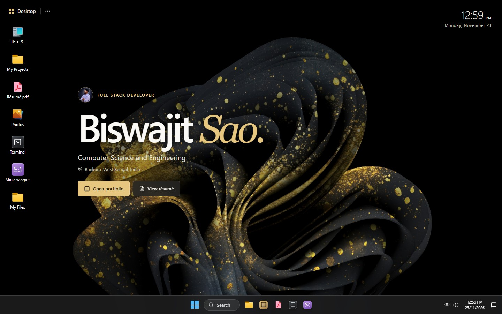

# Biswajit Sao | Desktop Portfolio

My portfolio is a Windows 11-inspired desktop built with React and TypeScript. Open **My Projects** to explore the software I’ve built, or choose **View résumé** to read my résumé without leaving the desktop.



## Explore the desktop

| App | What you can do |
| --- | --- |
| Portfolio | Browse professional, freelance, and personal projects, then explore my experience and technical skills. |
| PDF Reader | Switch between my résumé and CV, turn pages, zoom in, or download the original PDF. |
| File Explorer | Create folders and text files, edit notes, and drag items between folders. Changes are saved in your browser. |
| Command Prompt | Type `help` to list commands. Try `mkdir Notes`, then `cd Notes` to enter the folder you just created. |
| Photos | Browse four portraits in the gallery. |
| Minesweeper | Play an 8 × 8 board with ten mines. Use flag mode to mark suspected mines. |

Press **Ctrl + K** to search for apps and files. Right-click an empty area of the desktop to create a folder or open a terminal.

## Run locally

From the project directory, use Node.js 22.13 or later and npm.

```sh
npm ci
npm run dev
```

Open the local URL printed by Vite. To build and preview the production version, run the following commands.

```sh
npm run build
npm run preview
```

## Project structure

| Path | Contents |
| --- | --- |
| [src/data.ts](src/data.ts) | Project descriptions, skills, contact links, and document and photo listings |
| [src/App.tsx](src/App.tsx) | Desktop, Start menu, taskbar, and window management |
| [src/Windows11.css](src/Windows11.css) | Windows 11 theme and responsive desktop layout |
| [public/documents](public/documents) | Downloadable résumé and CV |
| [public/photos](public/photos) | Gallery portraits |

The interface uses Tailwind CSS and Lucide React icons. Mozilla PDF.js renders the documents inside the reader.
